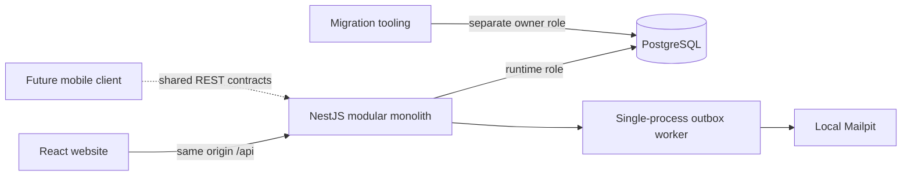

# Architecture

See [How LaroSentry works](system-framework.md) for the current beginner-friendly architecture, role/booking/payment/application diagrams, real data relationships and implemented-versus-planned service boundaries. [Local demo mode](demo-mode.md) adds a server-configured fixture-only verification policy at the existing guard boundary; it does not replace authentication, authorization or the deployment stack.

The website talks to one NestJS API through same-origin `/api` routing. Vite proxies requests to loopback port 4000. The API uses Prisma's PostgreSQL adapter to a shared PostgreSQL database. It has authentication, discovery, booking, community, submissions, administration and facility-operation controller boundaries. Shared admin access/decision and alert-rule helpers enforce critical policies; further module/service separation remains work as the pilot expands. The shared contracts package is convenience, not trust: every relevant API mutation parses its body on the server.

Opaque sessions stay in HttpOnly cookies. The browser-readable CSRF cookie contains a separate random token matched against its hash in the session. Mutations require the configured origin, JSON content type and a matching CSRF token when authenticated. There is no localStorage session token and no browser database connection.

Transactions group booking state, allocation, status history, notifications, outbox and audit events. Mail is delivered after commit, so SMTP failure does not roll back a confirmed booking. A stable outbox ID supplies message deduplication identity, though SMTP cannot guarantee exactly-once delivery across a crash.

The API currently runs as one local process with in-memory rate limiting and one worker. Do not scale it horizontally without distributed rate limiting and outbox claiming. Future mobile authentication transport needs a deliberate session/token design before mobile work begins; the booking/pricing/authorization rules should remain here in the API.

Route splitting separates authentication, workspace and Leaflet assets. Discovery is bounded to the pilot and paginates responses; in-memory price sorting is capped at 500 facilities and must be replaced with indexed database sorting before expansion.
