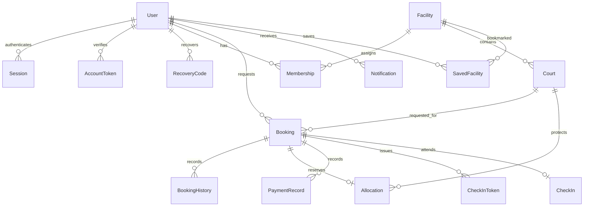

# Database and local services

PostgreSQL is required. This workspace uses portable PostgreSQL 17.11 from the official Windows distribution linked through EDB. `pnpm services:up` initializes a new private cluster only if `.local/pgdata/PG_VERSION` does not exist. It creates random local secrets only if `.env` is missing. It does not reset existing data. Port 5432 is bound to 127.0.0.1; Mailpit uses 1025 and 8025 on the same loopback address.

Three roles have distinct purposes: `postgres` initializes extensions/roles/databases; `larosentry_migrate` owns migration objects; `larosentry_app` performs normal API queries. The API loads runtime DATABASE_URL from `.env`; Prisma tooling and backups load the separate `.env.migrations` credential. Both files are ignored. Runtime has SELECT/INSERT on audit, booking history and payment records, with UPDATE/DELETE/TRUNCATE revoked. Migration/schema owners can still change these records; append-only application access is not tamper-proof against a database administrator.

## Native alternative

On another Windows machine, install the pinned Node/pnpm and PostgreSQL using official distributions, or download portable binaries to the paths described by scripts/services.mjs. On Ubuntu, install a supported PostgreSQL package, create SCRAM-authenticated migration/runtime roles, create `larosentry` owned by the migration role and enable btree_gist. Populate `.env` using `.env.example`. Do not paste credentials into shell history. Run `pnpm db:generate`, `pnpm db:migrate`, then explicitly `pnpm db:seed`. Provision Mailpit separately on loopback. Docker is optional and was unavailable here; a tested Docker workflow has not yet been supplied.

## Current entities

`User` contains the minimal account profile and eligibility/terms record. Session, AccountToken and RecoveryCode contain hashes, while the MFA secret is encrypted. Facility has simple daily hours, approved publication state and amenities. Court is independently priced/bookable. Membership scopes owners/staff to facilities and permission names.

Booking contains status, UTC interval, mode, guest count and immutable price/policy snapshots. BookingHistory is append-only. Allocation combines confirmed bookings and closures with one exclusion constraint. IdempotencyRecord binds a user and submission key to one request fingerprint/result. PaymentRecord is an append-only full-payment receipt record. CheckInToken is hashed and replaceable; CheckIn is unique per booking. SavedFacility, Notification and Outbox support the website. AuditEvent and AdminDecision are append-only for the runtime role. SecurityAlert is generated by the local rule processor and carries supporting event references.

RescheduleRequest stores proposed intervals and attributable decisions, with a partial unique index allowing one pending change per booking. Participation has a unique booking/user pair. GameInvitation stores recipient-bound hashes and expirations, with one pending invitation per booking/recipient. UserBlock stores directional account pairs. Booking records explicit publication, rules and offline guest counts. Review is reserved schema with no exposed workflow yet.

Migration five adds FacilityApplication and append-only AdminDecision, nullable AuditEvent reason, alert evidence/acknowledgement/resolution fields and security/general report targets. UserReport now has OPEN/REVIEWING/RESOLVED/DISMISSED states and an actual submission/review workflow. SecurityAlert is populated by the bounded local rule worker. Runtime can insert/read decisions but cannot update/delete them. Restrictions use the existing User.suspendedAt flag and immutable decision history, preserving booking and payment records. Role grants, restrictions and admin writes share a transaction lock to protect last-admin access.

Schema consolidation deliberately stores amenities as a bounded string array and one sport per court for this milestone. Variable operating days, price rules, sport join tables, media, reviews, facility editing and retention processors remain outstanding. Do not claim the complete requested normalized model has been delivered.

## Integrity

All interval endpoints use timestamptz. SQL rejects nonpositive intervals, invalid states/modes, negative prices and invalid capacities. `btree_gist` supports `(courtId =, tstzrange(start,end,'[)') &&) WHERE active`. The database therefore rejects two overlapping active allocations, even if concurrent API checks both observe an initially available court. Adjacent intervals are valid. Migrations apply with `migrate deploy`; do not use `migrate reset` on this workspace.

## Publication preparation update ? 2026-10-14

See [publication review](publication-review.md) for launch blockers and isolated demo setup. Demo seed/bootstrap commands now require recognized loopback demo/test databases; production remains gated. Migration 202610140006_policy_acceptance adds nullable privacyVersion and policyAcceptedAt fields without relabeling legacy acceptance. Registration validates and records the current shared policy bundle. New local demos create four fictional roles in a new database; no existing database is reset. Complete policy approval, retention/erasure, public support and deployment review before launch.
