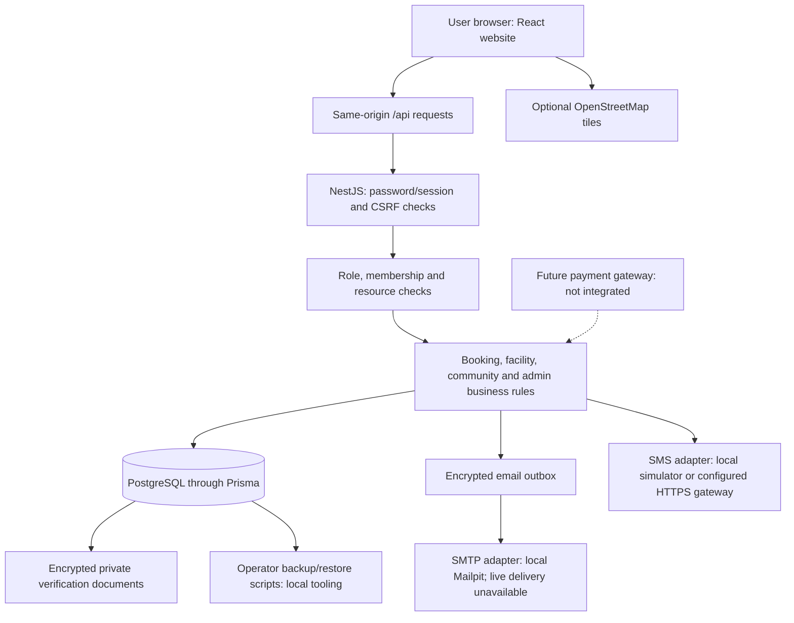
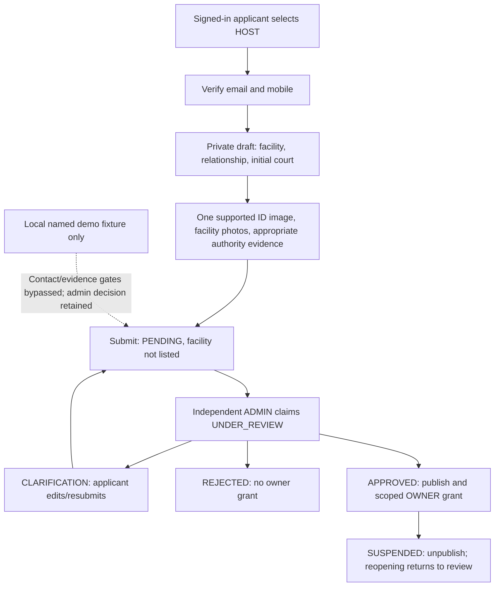
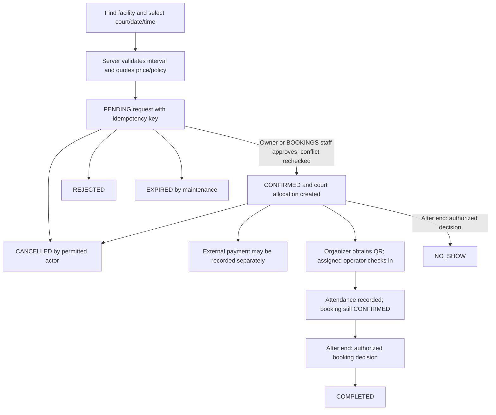
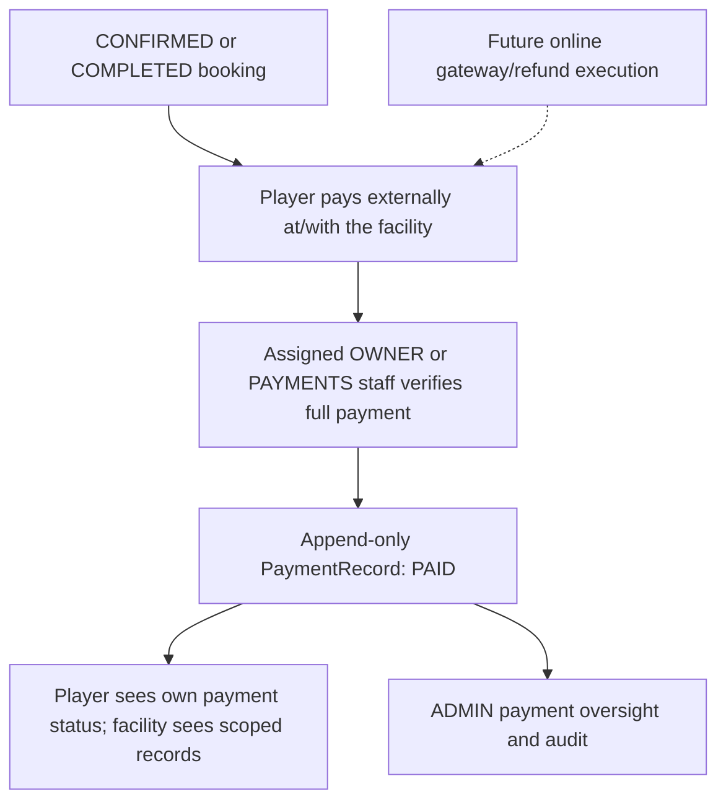
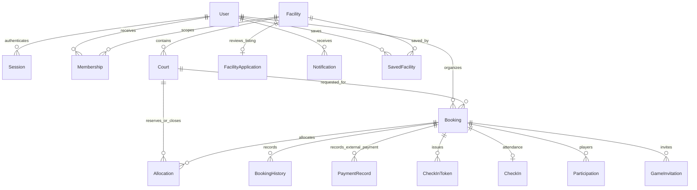
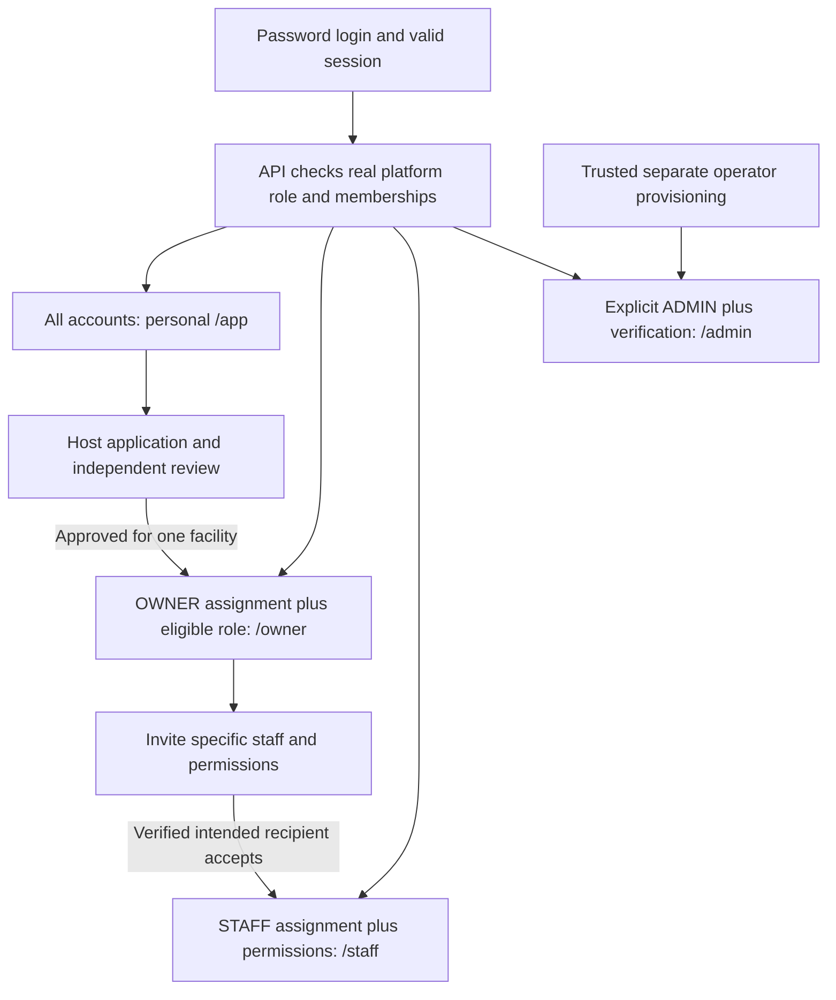

# How LaroSentry works

This guide describes the existing TypeScript/React/Vite, NestJS, Prisma and PostgreSQL project, inspected on 2026-10-17. It distinguishes working features from future integrations. For the new local-only verification bypass, see [demo-mode.md](demo-mode.md). For the online fictional pilot, see [render-pilot.md](render-pilot.md): local bypass is never enabled there.

## 1. System overview

Players discover sports courts and request time. An assigned owner or authorized staff member decides whether to confirm a request. Facility operators record external payments and attendance. Separately authorized administrators review applications, reports and security alerts. Booking, payment, identity review and permission states are separate decisions.

The browser never connects directly to PostgreSQL or receives database credentials. React presents pages; the API makes authorization and business decisions.

## 2. User types

Every account can use personal player features when its verification requirements are satisfied. `User.role` is a platform role: PLAYER, FACILITY_OWNER, FACILITY_STAFF or ADMIN. `Membership` separately links a user to an individual facility as OWNER or STAFF. Staff permissions are BOOKINGS, PAYMENTS and ATTENDANCE. A global role does not grant access to every facility.

## 3. Authentication

Passwords are hashed with Argon2id. Login creates an opaque server-side session and separate CSRF token; the browser receives cookies, not a JWT in localStorage. Sessions expire after twelve hours and require activity within thirty minutes. Restrictions, explicit revocation and certain account changes end access. Online cookies are Secure, HttpOnly for the session, and SameSite=Lax.

New signup collects email, a normalized Philippine mobile number, nickname, password confirmation, adult declaration and separate policy acceptances. Signup creates PLAYER only. Unverified login sessions can use restricted onboarding; normal business functions require the applicable contact verification. Normal privileged actions require both contacts and authenticator MFA. A synthetic fixture timestamp is not evidence of actual delivery.

## 4. Local demo mode

`DEMO_MODE=true` requires a dedicated loopback `larosentry_demo_<timestamp>` database, matching launcher marker and loopback application origin. Production/public startup refuses it. Only the four named `@demo.example.test` fixtures receive a verification bypass, after normal password login. Other accounts remain subject to normal verification.

It bypasses contact/onboarding gates, privileged MFA gates and application evidence requirements for those fixtures. It never writes false verification timestamps or MFA enrollment. It does not skip role/membership checks, self-review prevention, separate admin approval, confirmation/reasons, file validation, booking conflicts, prices, payment rules, CSRF, suspension or session checks. Demo evidence decisions say `DEMO_BYPASSED`, not genuinely verified. The local UI displays DEMO MODE. Restart with the flag false to restore normal gates; prior fictional business decisions are not undone.

## 5. Player workspace

`/app` shows recommendations; `/app/bookings` shows personal bookings. Other personal pages cover saved facilities, public games, invitations, notifications, reports, profile, contact verification, preferences and sessions/security. Optional preferences are skippable and editable. Recommendations use rules and published facility data, not an AI model, and do not restrict ordinary search. Public list/map discovery and availability remain available separately.

## 6. Owner workspace

`/owner` requires an actual OWNER assignment and an eligible platform role. It connects overview, facilities, courts, calendars, reservations, payments, attendance, staff, reviews/report status, activity and settings. The owner edits only assigned facilities. The scheduler provides court prices, durations, operating exceptions, maintenance and manual bookings. Owner report views omit private narratives/reporter identity. Review lists do not imply a complete customer-rating submission workflow.

## 7. Staff workspace

`/staff` requires a STAFF assignment. BOOKINGS allows assigned booking operations; PAYMENTS allows eligible external-payment recording; ATTENDANCE allows check-in. Missing permissions are denied in the API. Staff do not gain owner settings, staff administration or platform administration merely from being staff. Separately granted OWNER membership can legitimately add an owner workspace.

## 8. Admin workspace

`/admin` requires ADMIN and normal privileged verification, or the strictly local fixture bypass. Pages cover counts with definitions, facility applications/verification, users/restrictions, facilities, booking/payment oversight, reports, alerts, audit and measured health. Platform oversight does not implicitly grant facility operator membership or personal access to someone else's private game.

Restrictions and decisions require reasons/confirmation as implemented; decisions and permission changes are audited. Self-restriction/self-review are denied, and last-usable-admin safeguards remain. Lists are bounded/paginated. Password hashes, tokens, OTPs and MFA secrets are not admin directory fields.

## 9. Facility application process

Choosing HOST records intent; it does not grant owner permissions. A user saves private facility drafts, enters valid facility/contact/initial-court information, identifies their relationship and submits required evidence. The applicant sees progress and decisions. A clarification reopens the same draft; resubmission retains the existing application/facility link. Only approval publishes the facility and grants the appropriate facility-specific OWNER membership. Role-changing approval revokes sessions so the user signs in again.

## 10. Facility verification

An upload means submitted evidence, not identity authenticity. Images are sanitized PNG/JPEG, encrypted in PostgreSQL and retrieved only by the assigned eligible admin reviewer during permitted review states. Managers/representatives normally need authority evidence. Uploaded content expires from active storage; backup handling is a separate operator responsibility. Demo bypass does not make an applicant an admin or let admins approve themselves.

## 11. Booking lifecycle

**PENDING does not reserve the time slot.** Confirmation rechecks conflicts and price/policy snapshots inside a transaction; PostgreSQL rejects overlapping active allocations. Requests can expire without approval. Idempotency prevents duplicate effects on retry. Reschedule requests have their own decision records; a failed reschedule leaves the original booking intact. Same-day/past times, closures and duration rules are checked server-side, with PHT presentation and UTC storage.

## 12. Payment lifecycle

There is no integrated payment gateway, online charge or automatic refund. The operator records the full server-calculated amount and an allowed method/reference. Self-verification, duplicate full payments and unauthorized facilities are denied. A payment record does not confirm a pending booking or complete attendance. Booking cancellation does not execute a refund. Corrections/refunds need the documented external review; history is not silently rewritten. No card number or PIN is collected.

## 13. QR check-in

A confirmed booking's organizer can issue a QR token. Only its hash is stored. Replacement, cancellation and rescheduling revoke prior tokens. An assigned ATTENDANCE operator checks the token or booking reference, facility, status and arrival window (thirty minutes before start through end). One attendance record prevents replay. There is no built-in camera scanner; the existing QR display/token/reference workflows are the implemented interfaces. Check-in alone does not set COMPLETED.

## 14. Notifications

Booking/application/invitation decisions create database notifications and sometimes encrypted outbox messages within their transaction. Users see only their own notifications. The mail worker delivers after commit, with bounded retries. Queued does not mean delivered. Local Mailpit captures messages; real email and SMS delivery on the free Render pilot are unavailable.

## 15. Reports

Signed-in users submit reports and track their own status. Target access is checked. Admins record decisions/reasons through OPEN, REVIEWING, RESOLVED or DISMISSED states and cannot self-adjudicate. Owner report status is minimized. `/security` and help explain the reporting route; there is no configured anonymous public support mailbox.

## 16. Security monitoring

Bounded rules inspect recent audited events for repeated failed logins, admin denials and authentication rate-limit events. `SecurityAlert` stores rule, severity and supporting event references. Admins acknowledge/resolve with notes. Alerts are human-review items, not proof of an attack; thresholds never automatically punish a user. The worker is not comprehensive attack detection, and it pauses while a free Render instance sleeps.

## 17. Audit logging

Actions record actors where known, action, outcome, time, correlation/resource and relevant reasons. The runtime database role cannot update/delete important audit/decision/payment/history records. A database/schema owner is a separate trust boundary. Passwords, OTPs, tokens and full sensitive bodies must not be logged. Local demo bypass and evidence bypass have explicit audit events, rather than pretending normal verification happened.

## 18. Database relationships

Profile/preferences and platform role are fields on `User`; there are no separate Profile or Role models. Staff access uses `Membership`, not a separate staff table. Other real models are AccountToken, RecoveryCode, ScheduleException, RescheduleRequest, IdempotencyRecord, Outbox, AuditEvent, SecurityAlert, UserBlock, Review, UserReport, AdminDecision, VerificationChallenge, FacilityDraft, VerificationDocument and StaffInvitation. Some workflow links are scalar IDs handled by the application/migration constraints rather than explicit Prisma relation fields: application applicant/reviewer/draft, report reporter/target, audit actor/resource, document draft and invitation recipient/facility. Review exists in schema without a complete public submission workflow.

## 19. External services

| Service       | Actual implementation and current boundary                                                                                           |
| ------------- | ------------------------------------------------------------------------------------------------------------------------------------ |
| PostgreSQL    | Real persistent application database; separate migration/runtime identities.                                                         |
| Email         | Encrypted outbox and SMTP adapter; local Mailpit. Public free pilot explicitly unavailable.                                          |
| SMS           | Budgeted expiring OTP challenges; local encrypted simulator; configurable HTTPS gateway adapter. No real provider configured/tested. |
| Maps          | Optional OpenStreetMap tile display; list fallback. No required precise GPS.                                                         |
| Private files | Sanitized encrypted images in PostgreSQL; no public upload directory or object-storage integration.                                  |
| Payments      | External payment recording only; gateway/refund execution are future work.                                                           |
| Backups       | Operator scripts for local backup/restore testing; Render free DB has no managed backups and expires.                                |

## 20. Deployment architecture

Locally, Vite proxies `/api` to a loopback NestJS process. The dedicated demo uses website 5176/API 4011, PostgreSQL 5432 and Mailpit 8025; all local services bind to loopback. Demo setup creates a separate database; starting it preserves existing accounts/passwords/reservations.

The live free Render pilot serves compiled React assets and API from one HTTPS Node process, with private PostgreSQL, a private secret file and a separately configured test dataset. It never enables local DEMO_MODE. Services sleep, background timers pause, and the free database expires. General commercial deployment remains gated. Hostinger migration is planned, not implemented; it requires a separate restore/provider/operations review. GitHub stores source; pushing source is separate from deployment.

## 21. Role/permission matrix

Normal verification applies unless the narrowly scoped local fixture bypass is active. “Assigned” always means the exact relevant membership, not a global role.

| Feature                                                 | PLAYER              | OWNER                     | STAFF                              | ADMIN                                      |
| ------------------------------------------------------- | ------------------- | ------------------------- | ---------------------------------- | ------------------------------------------ |
| Public court discovery/details                          | Yes                 | Yes                       | Yes                                | Yes                                        |
| Own bookings, QR, saved items, reports, preferences     | Own only            | Own only                  | Own only                           | Own only                                   |
| Owner workspace/settings/staff management               | No                  | Assigned OWNER            | Only with separate OWNER           | Only with explicit OWNER                   |
| Court rules/prices and scheduler management             | No                  | Assigned OWNER            | No owner controls                  | Explicit OWNER for these controls          |
| Booking decisions/closures                              | No                  | Assigned                  | Assigned BOOKINGS                  | Assigned operator membership               |
| External full-payment recording                         | No                  | Assigned; not own payment | Assigned PAYMENTS; not own payment | Assigned operator; not own payment         |
| Check-in/attendance                                     | Own QR display only | Assigned                  | Assigned ATTENDANCE                | Assigned operator                          |
| Facility application                                    | Apply/own status    | Apply/own status          | Apply/own status                   | Apply; another admin reviews               |
| Platform applications/users/reports/alerts/audit/health | No                  | No                        | No                                 | ADMIN only                                 |
| Platform facility/booking/payment oversight             | No                  | No                        | No                                 | ADMIN only                                 |
| Private verification images                             | No                  | No                        | No                                 | Assigned reviewer and permitted state only |
| Public signup into privileged role                      | Never               | Never                     | Never                              | Never                                      |

An owner can invite staff with selected facility permissions. The invited email must sign in, satisfy normal contacts and accept an unexpired single-use invitation; no role comes from simply opening a URL. ADMIN remains separately provisioned by the trusted operator, never granted from an email domain or public application.

## 22. Security boundaries

UI navigation is convenience, not permission. APIs enforce scope even for direct list/detail/mutation/file requests. Prisma/parameterized SQL and server validation remain authoritative. React encodes text. Sessions/CSRF, rate limits, upload validation, encryption and audit minimization remain in demo mode. Local bypass has no query/header/client toggle or universal password. Requests from suspended/revoked accounts fail. Never expose local secrets, fixtures, MFA artifacts, Mailpit or database ports publicly.

## 23. Currently implemented

Working code covers separate role workspaces, verified registration/onboarding, optional preferences/recommendations, private facility drafts/manual review, scoped staff invitations, discovery/calendars/scheduler, conflict-safe request/approval/rescheduling, external payment recording, QR/reference attendance, public/private game participation, notifications/reports, admin restrictions/alerts/audit/health and the explicitly local demo bypass. Exact test results belong in [progress](progress.md); this list is not proof of production provider delivery or a claim that every possible edge case was tested.

## 24. Planned or incomplete

Real email/SMS delivery configuration and testing, external ID authenticity checks, payment gateway/online refunds, QR camera capture, complete customer review submission, anonymous support, commercial policy approval, production deletion/backup/KMS operations, distributed rate limiting/outbox coordination and Hostinger migration remain incomplete or external setup. The free pilot is not an attack-proof system or commercial launch approval. No new integrations are implied by these diagrams.

## Client-presentation workflows (2026-10-17)

The existing stack, schema, booking state machine and privileges are unchanged. `/app` now starts with database-backed counts of this player's unexpired pending requests, confirmed upcoming bookings, published saved facilities and unread notifications, plus five recent bookings and four updates. Recommendations remain explainable and accessible below the overview. Owner/staff dashboards add permission-aware links to actual booking, calendar, payment and attendance tools. Admin adds registered-user/published-facility/external-payment totals and five recent admin audit events; these are not security scores.

Reporting now searches/selects named published facilities or currently public games. `/report-targets` requires an account; facilities are paginated twenty at a time. Games reuse the existing public-game privacy/blocking checks and search its bounded sixty-game discovery window; this is not a complete historical-game search. Submission independently revalidates the chosen target. GENERAL/SECURITY/PRIVACY reports need no resource ID. Other users' profiles/private games are never offered as report targets.

The homepage explains player, organizer and facility-management paths; facility cards show actual court counts/sports, not real-time availability. The calendar explains request versus reservation, and booking details explain external payment records and private QR use. Existing approvals, conflicts, cancellation, rescheduling, payment permissions and check-in windows remain authoritative.

Use [the client presentation guide and checklist](demo-presentation-guide.md) for eight role-based scenes, fictional payment/check-in demonstrations and limitations. `demo:scenarios` adds a daily transactional scenario batch only to the selected recognized local demo database. It uses a dedicated fictional presentation court to avoid the existing calendar fixtures, preserves prior records/decisions and refuses production/Render/public-pilot configurations. For a fresh rehearsal, select a new database with `demo:setup`; retained databases/history are not deleted. Never copy these fixtures or local bypass settings to Render. The guide lists unimplemented integrations explicitly.

## NOLTA court lifecycle and light/dark appearance - 2026-10-17

[Updated NOLTA behavior](nolta-scheduler.md#court-lifecycle-compact-navigation-and-themes---2026-10-17) adds safe court archival/status/conflict checks, normalized name validation and a more compact three-tab user experience. Profile/security/logout stay in the main LaroSentry account system. USER MODE / ADMIN MODE describe the active authorized workspace, including facility-owner scope; badges never grant access. The global header theme button persists a non-sensitive local light/dark preference. Migration 202610170009 is additive; shared surface values, reservations, payments, IDs and history are retained. No production deployment accompanies this update.
